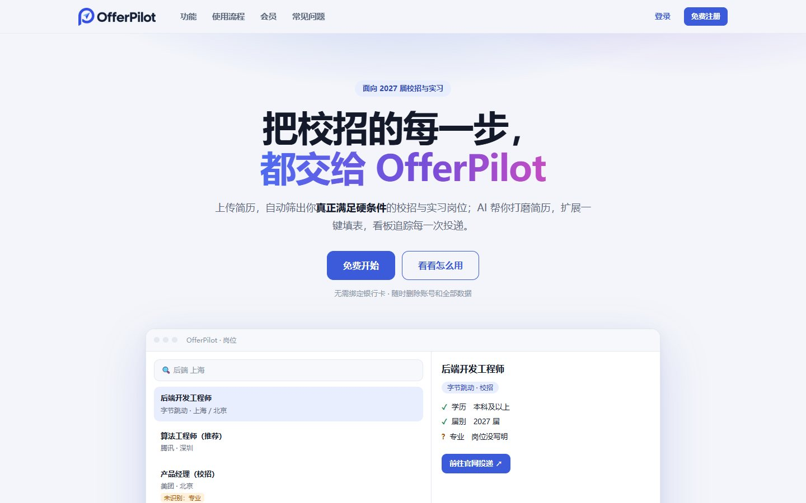
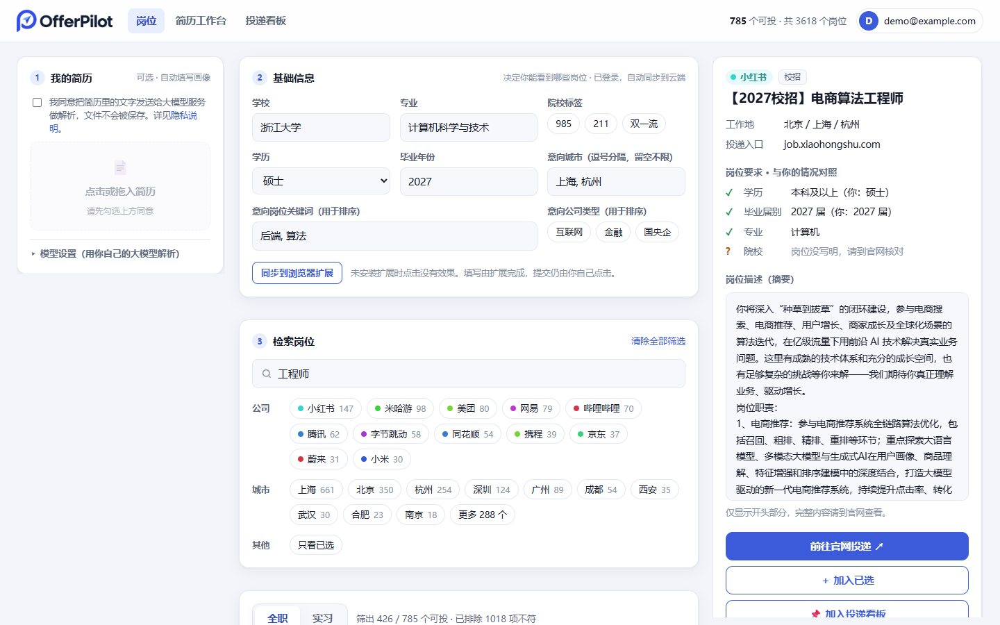
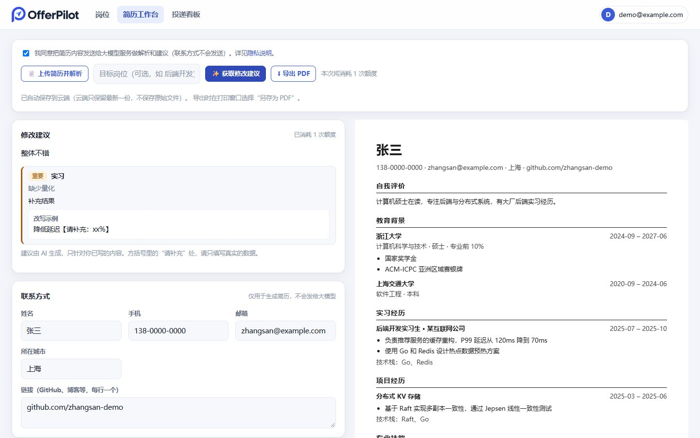
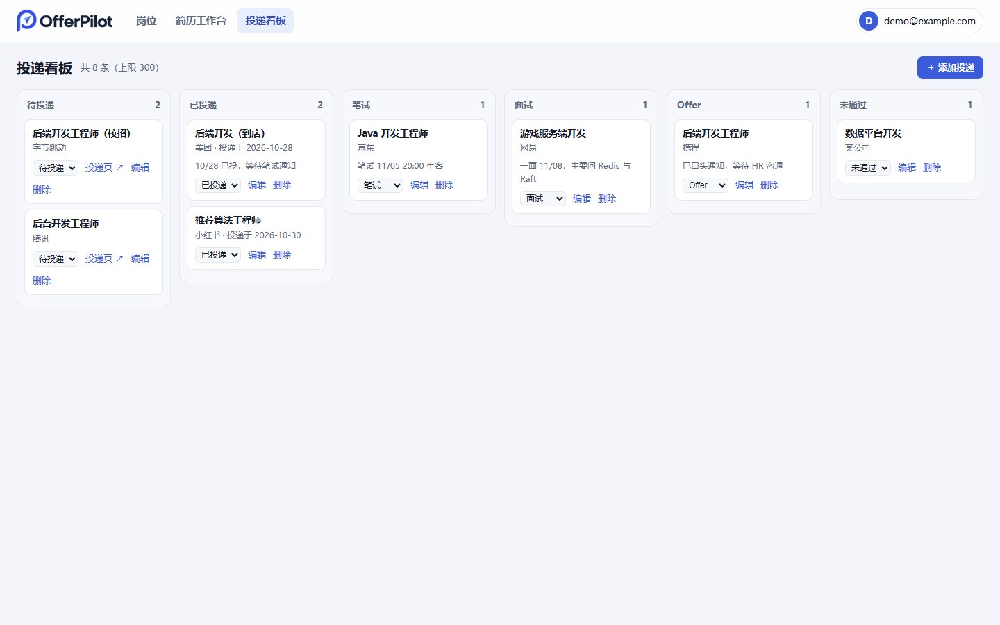
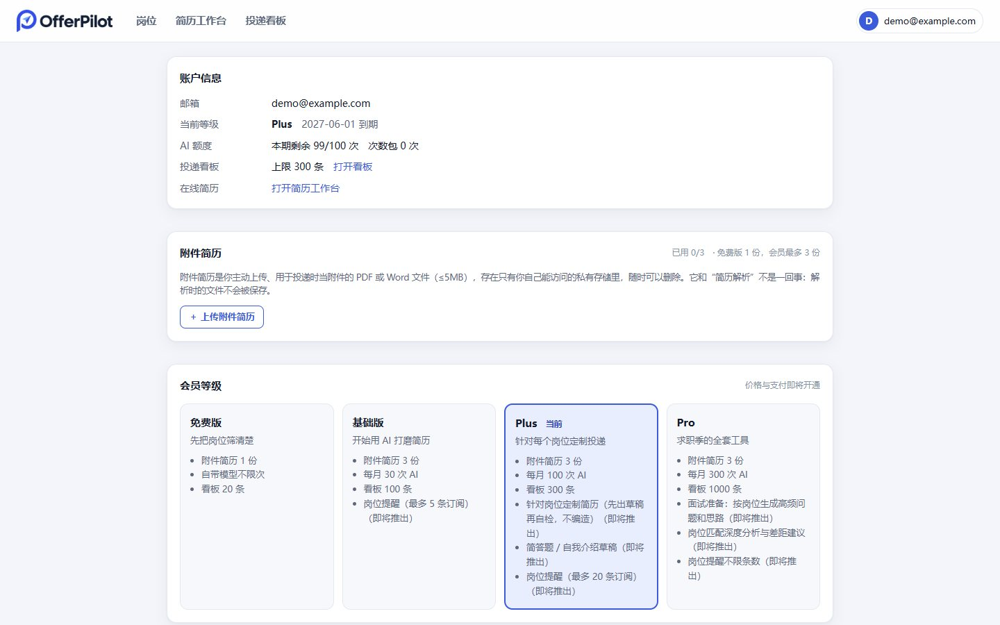
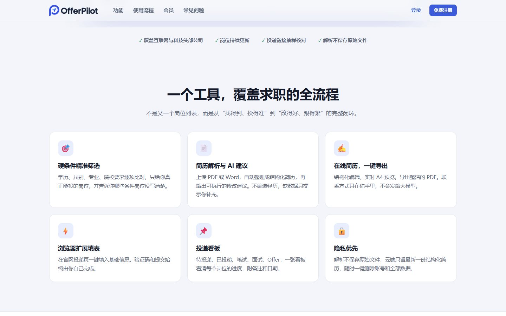
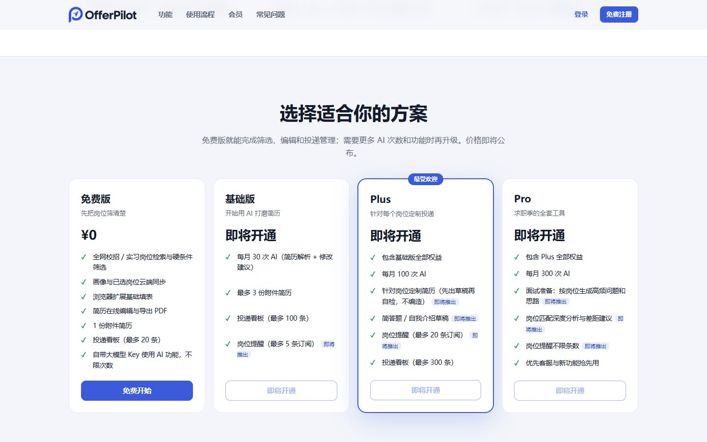

<p align="center">
  
</p>

<p align="center">
  <b>面向校招与实习的岗位匹配、简历打磨与投递管理平台</b><br>
  只看你真正满足硬条件的岗位 · AI 帮你改简历 · 看板追踪每一次投递
</p>

<p align="center">
  <a href="#在线演示">在线演示</a> ·
  <a href="#功能介绍">功能介绍</a> ·
  <a href="#使用说明">使用说明</a> ·
  <a href="#部署">部署</a> ·
  <a href="#项目状态与路线图">路线图</a>
</p>

<p align="center">
  
</p>

---

## 在线演示

- **在线体验**：<https://offerpilot-rose.vercel.app>
  用邮箱验证码注册登录后即可使用岗位检索、简历工作台、投递看板。演示站部署在免费档上，邮件发送和 AI 额度都有限制，偶尔可能不可用。
- **本地体验**（无需账号、无需数据库）：见下面的[快速开始](#快速开始本地试用)，几分钟就能跑起来。

### 界面预览

| 岗位检索：硬条件筛选 + 要求对照 | 简历工作台：编辑、预览、AI 建议 |
|:---:|:---:|
|  |  |
| **投递看板** | **账户与会员** |
|  |  |

<details>
<summary>更多截图：首页功能区、会员方案、登录</summary>

| 功能介绍 | 会员方案 |
|:---:|:---:|
|  |  |

<p align="center"></p>

</details>

> 截图使用的是虚构的演示账号和演示简历，岗位数据来自各公司官网公开的校招页面。

---

## 功能介绍

### 1. 岗位检索与硬条件筛选
- 已覆盖 **14 家公司、约 3,600 个校招与实习岗位**：字节跳动、腾讯、美团、京东、网易、哔哩哔哩、小红书、米哈游、携程、小米、蔚来、MiniMax、同花顺、Jane Street。
- 填写**画像**（学校与院校标签、专业、学历、毕业年份、意向城市、意向岗位、意向公司类型）后，系统按**硬条件**逐项比对：学历、毕业届别、专业、院校要求、工作地。不满足的直接排除，页面会告诉你排除了多少项。
- 岗位**没有写清楚的条件**不会被当作满足，而是标记为“未识别”，提醒你投递前自己核对——**宁可留空也不猜**。
- 按意向岗位关键词、公司类型、城市排序；支持关键词检索，公司、城市、“只看已选”筛选。
- 点开岗位，右侧显示详情：学历、届别、专业、院校逐项与你的情况对照（✓ 满足 / ? 岗位没写明）、岗位描述摘要、官网投递入口，可加入已选或投递看板。

### 2. 简历解析与 AI 修改建议
- 上传 PDF、Word(.docx) 或 txt，自动整理成结构化画像和简历（教育、经历、技能），**解析的文件只在内存中处理，不落盘**。
- **修改建议**：指出缺少量化结果、只写职责不写成果、技术栈与成果对不上等问题，并给出改写示例。严格依据你已写的内容，**不编造**；缺数据时只放“【请补充：xx】”占位，让你自己填真实数字。
- 支持填写目标岗位，建议会说明哪些经历相关、哪些可以弱化。

### 3. 简历工作台
- 结构化在线编辑：联系方式、自我评价、教育、实习/项目/科研/校园/奖项、技能。
- 实时 A4 预览，**一键导出 PDF**（浏览器“另存为 PDF”）。
- 联系方式只用于生成简历，**不会发送给大模型**。
- 登录后自动保存到云端，云端**只保留最新一份**；本机和云端不一致时由你选择以哪份为准，不会静默覆盖。

### 4. 投递看板
- 六列看板：待投递 → 已投递 → 笔试 → 面试 → Offer / 未通过，支持**拖拽**或下拉移动。
- 岗位详情里一键“加入投递看板”，也可手动添加；每条可记链接、投递日期、备注（笔试时间、面试反馈等）。

### 5. 附件简历
- 免费版 1 份、会员最多 3 份，只收 PDF / Word（≤5MB），存放在只有你本人能访问的私有存储里，可随时下载、删除。
- 上传时检查文件头，伪造扩展名的文件会被拒绝。
- 与“简历解析”不同：解析时的原文件不会被保存，附件是你主动上传、用于投递时当附件的文件。

### 6. 浏览器扩展（基础版）
- 在网页端点“同步到浏览器扩展”，画像传入扩展；到官网投递页点扩展图标，一键填入姓名、学校、专业、学历、毕业年份。
- **只填、不提交**：自定义下拉框列为“需要你手动选择”，检测到验证码就停下交给你，**验证码和提交始终由你自己完成**。

### 7. 两种使用方式

| | 自己部署（自带模型） | 托管版（你的网站） |
|---|---|---|
| AI 模型 | 在页面“模型设置”或 `.env` 里填你自己的 Base URL / API Key / 模型名（任意 OpenAI 兼容接口） | 站点提供模型，按额度计费；也可以自带模型，免费且不扣额度 |
| 账号 | 不需要 | 邮箱验证码登录 |
| 费用 | 模型费用由你自己承担 | 免费版 + 基础版 / Plus / Pro 会员（价格待定） |

### 8. 会员方案（框架已实现，价格待定）

| | 免费版 | 基础版 | Plus | Pro |
|---|---|---|---|---|
| 每月 AI 次数（解析 + 建议共用） | 自带模型不限 | 30 | 100 | 300 |
| 附件简历 | 1 份 | 3 份 | 3 份 | 3 份 |
| 投递看板条数 | 20 | 100 | 300 | 1000 |
| 简历编辑 / 导出 PDF / 岗位筛选 / 扩展填表 | ✓ | ✓ | ✓ | ✓ |
| 岗位定制简历、简答题草稿 | – | – | 即将推出 | 即将推出 |
| 面试准备、岗位匹配深度分析 | – | – | – | 即将推出 |

详见 [docs/PRODUCT.md](docs/PRODUCT.md)。

### 隐私原则
- 不登录时，画像和已选岗位只保存在你的浏览器里。
- 简历解析**不保存原始文件**；云端只保存解析、编辑后的**最新一份结构化简历**。
- 你的大模型 API Key 只保存在你的浏览器里（默认仅当前会话），**永远不上云**。
- 一键删除账号，连同画像、简历、附件、看板和额度记录一并清除。
- 详见应用内的 `/privacy` 页面。

---

## 使用说明

### 在线使用（托管版）

1. 打开站点，点“免费注册”，输入邮箱，收验证码登录（没收到请看垃圾邮件箱）。
2. **岗位页**：可选先上传简历自动填写画像（先勾选同意说明），核对基础信息，然后检索、筛选、点开岗位看要求对照。
3. 勾选感兴趣的岗位，或点“加入投递看板”。
4. **简历工作台**：上传简历解析（或手动填写），编辑，点“获取修改建议”，满意后“导出 PDF”。
5. **投递看板**：把岗位拖到对应阶段，记录备注和日期。
6. （可选）安装浏览器扩展，到官网投递页一键填基础信息。

### 快速开始（本地试用）

不需要账号、数据库，也不需要付费。需要：Node.js 20+、本机已安装的 Google Chrome（采集器使用）。

```bash
git clone git@github.com:atlasmarkz/offerpilot.git
cd offerpilot
npm install

# 1) 采集岗位（需要本机 Chrome，约 6 分钟；结果写到 apps/crawler/data/jobs.json）
npm run crawl -w @offerpilot/crawler

# 2) 启动网页端
npm run dev -w @offerpilot/web          # 打开 http://localhost:3000
```

本地模式下没有账号体系，首页会直接进入岗位页；岗位来自本地采集结果，未审核的岗位也会展示并标注。

### 配置你自己的大模型（简历解析 / 修改建议）

任选一种：

- **在页面里填**：左侧“模型设置”，填 Base URL、API Key、模型名，点“测试连接”。密钥只存在你的浏览器里。
- **用 `.env`**：复制 `.env.example` 为 `.env`，填写 `LLM_BASE_URL`、`LLM_API_KEY`、`LLM_MODEL`（任意 OpenAI 兼容接口，如 OpenAI、MiniMax、本地 Ollama 等）。

> 本地开发时可以连 `http://localhost` 的本地模型；生产环境为防止被用来访问内网，只允许 `https` 的公网地址。

### 安装浏览器扩展

```bash
cd apps/extension
npx wxt build                          # 产物在 .output/chrome-mv3
```

在 Chrome 打开 `chrome://extensions`，开启“开发者模式”，“加载已解压的扩展程序”，选择 `apps/extension/.output/chrome-mv3`。

上架 Chrome 应用商店的打包、文案、截图和提交清单见 [docs/CHROME_STORE.md](docs/CHROME_STORE.md)。

使用：网页端填好画像 → 点“同步到浏览器扩展” → 打开官网投递页 → 点扩展图标“填写当前页面”。线上域名需要在构建时指定：`WXT_WEB_ORIGIN=https://你的域名 npx wxt build`。

### 维护岗位数据（管理员）

```bash
npm run crawl  -w @offerpilot/crawler                  # 采集（全部先是“待审核”）
npm run verify -w @offerpilot/crawler                  # 每个数据源抽样打开投递页，通过就整组批准
npm run review -w @offerpilot/crawler -- summary       # 按公司看审核进度（也可 list / approve / reject）
npm run sync   -w @offerpilot/crawler                  # 同步到 Supabase（线上读取的就是这里）
```

### 开通会员（支付接入前由管理员手动发放）

```bash
npm run billing -w @offerpilot/crawler -- grant     用户邮箱 20            # 发 20 次
npm run billing -w @offerpilot/crawler -- subscribe 用户邮箱 plus 30       # 开通 Plus，30 天
npm run billing -w @offerpilot/crawler -- show      用户邮箱               # 查看余额和最近用量
```

---

## 技术架构

```
┌────────────┐   采集   ┌──────────────┐  同步  ┌────────────────────────────┐
│ 各公司官网  │ ───────▶ │  crawler     │ ─────▶ │ Supabase                   │
│ (公开页面)  │ Playwright│ 抽取/验证    │        │ Postgres + 行级安全 + 存储   │
└────────────┘          └──────────────┘        │ 认证（邮箱验证码）            │
                                                └─────────────▲──────────────┘
┌──────────────┐   同步画像   ┌───────────────────┐            │ 用户令牌
│ 浏览器扩展    │ ◀────────── │ web (Next.js 14)  │ ───────────┘ 服务端读写
│ WXT / MV3    │   一键填表   │ 页面 + API 路由    │ ──▶ 大模型（站点 MiniMax / 用户自带）
└──────────────┘             └───────────────────┘
```

| 目录 | 说明 |
|---|---|
| `apps/web` | 网页端：产品首页、岗位检索、简历工作台、投递看板、账户页；登录、云同步、额度、附件等 API |
| `apps/crawler` | 岗位采集器：各平台适配器、硬条件抽取、链接抽样验证、审核、同步、管理员额度命令 |
| `apps/extension` | 浏览器扩展（WXT）：画像同步、按标签填表 |
| `packages/shared` | 共享的 zod 数据模型（画像、岗位）、硬条件过滤、会员等级定义 |
| `supabase/migrations` | 数据库迁移：岗位表、用户数据、额度与订阅、简历、附件与看板 |
| `docs` | 产品与收费规划、截图 |

**技术栈**：TypeScript monorepo（npm workspaces）· Next.js 14 · React 18 · Supabase（Postgres、认证、存储、行级安全）· Playwright · WXT · zod · vitest。

**几个关键设计**
- **硬条件匹配可解释**：比对逻辑在 `packages/shared`，有单元测试；岗位字段抽取以规则为主，宁可留空也不猜。
- **额度扣减原子且可退还**：由数据库函数完成，先订阅额度后次数包，并发不超扣，模型失败自动退还；这些函数只有服务端密钥能调用。
- **会话在 httpOnly Cookie**：页面脚本读不到令牌；改数据的接口校验请求来源。
- **自带模型的防护**：服务端替用户请求模型地址时，只允许 https、拒绝内网地址、不跟随跳转，防止被利用访问内网。

---

## 开发

```bash
npm install
npm test                                   # 全部单元测试
npm run typecheck                          # 全部类型检查
npm run dev -w @offerpilot/web             # 网页端开发服务器
npm run dev -w @offerpilot/extension       # 扩展开发模式
npm run build -w @offerpilot/web           # 生产构建
```

新增岗位站点：参见 [apps/crawler/README.md](apps/crawler/README.md)（用发现工具定位列表接口，约 50 行写一个适配器，并必须验证详情链接）。

---

## 部署

免费方案（Vercel + Supabase + GitHub Actions）、邮箱验证码与发信配置、托管版计费、以及流量变大后的付费时机，见 **[DEPLOY.md](DEPLOY.md)**。要点：

1. Supabase 建项目，依次运行 `supabase/migrations/` 里的 SQL（`0002` ~ `0005`）。
2. 本机采集、验证、同步岗位。
3. Vercel 导入仓库，Root Directory 选 `apps/web`，填 Supabase 环境变量。
4. Supabase 里配置邮件模板（带 `{{ .Token }}` 验证码）和自己的 SMTP。
5. 想开收费：设置 `BILLING_ENABLED=1` 和服务端的 `SUPABASE_SERVICE_KEY`。

---

## 项目状态与路线图

| 模块 | 状态 |
|---|---|
| 岗位采集（14 家公司）、硬条件抽取、抽样验证、同步 | ✅ 可用 |
| 岗位检索与筛选、要求对照详情 | ✅ 可用 |
| 简历解析、在线编辑、预览、导出 PDF、AI 修改建议 | ✅ 可用 |
| 登录（邮箱验证码）、云同步、删除账号 | ✅ 可用 |
| 附件简历、投递看板 | ✅ 可用 |
| 额度 / 订阅（基础版、Plus、Pro）与管理员发放 | ✅ 框架可用，价格待定 |
| 浏览器扩展 | 🟡 基础版（通用填表，仅点击时运行，无常驻网站权限；已在真实浏览器中验证；商店上架材料已备好），官网专用适配器、经历与简答题填写未做 |
| 支付（微信 / 支付宝） | ⏳ 等营业执照与商户资质 |
| 岗位定制简历、简答题草稿、面试准备、岗位匹配深度分析 | ⏳ 规划中 |
| 岗位提醒 | ⏳ 规划中 |
| Docker 自部署包 | ⏳ 规划中 |
| 手机号 / 微信登录 | ⏳ 需要短信或微信开放平台企业资质 |
| 更多公司（阿里、华为、蚂蚁、OPPO、滴滴等） | ⏳ 部分公司暂无可用的公开列表接口或需要登录，详见采集器文档 |

**已知限制**
- 岗位数据抽样验证链接可打开，但不保证每个岗位都没下架，请以官网为准。
- 部分站点的岗位没有正文，硬条件为空（匹配时视为不限，并标“未识别”）。
- 网易的岗位没有独立详情页，投递入口落在项目岗位列表。

---

## 合规与免责声明

- 采集仅针对各公司官网**公开**的校招页面：遵守 `robots.txt`、同一主机限速、带可识别的 User-Agent，不处理登录和验证码；`robots.txt` 禁止的站点不采集。
- 岗位只展示标题、城市和要求摘要，并链接回官网投递；信息可能滞后或有误，**请以官网为准**。
- 收费上线前，请自行核实支付资质、网站备案、生成式人工智能服务登记、个人信息保护、税务发票等要求，详见 [docs/PRODUCT.md](docs/PRODUCT.md)。本文档不构成法律意见。
- 本仓库暂未指定开源许可证，在作者明确授权前，默认保留所有权利。
